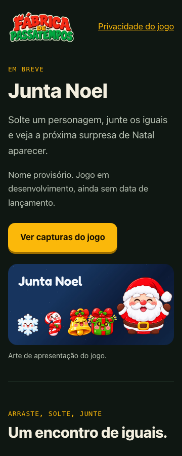
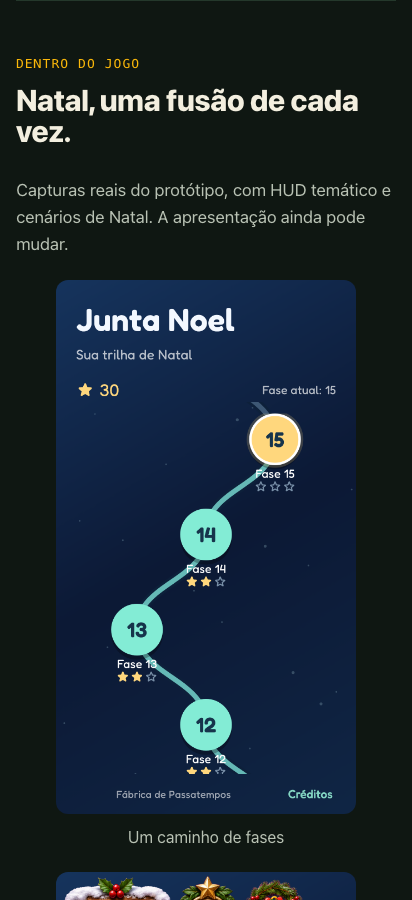
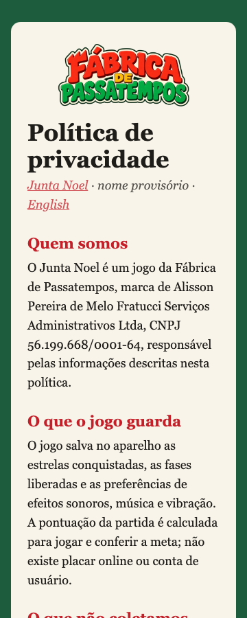

# Conferência local

Chrome headless próprio e mudo, CDP com viewport explícito360/412×900. Assert innerWidth=scrollWidth passou nas duas páginas. Oito capturas: apresentação, galeria e política PT/EN. Fontes remotas bloqueadas para conferir fallback do sistema; não comprova disponibilidade pública da página. Chrome/perfil/servidor próprios encerrados.

As seis capturas do jogo foram refeitas em1080×1920 pelo Flutter/Flame nativo, a partir da campanha zerada e toques reais até a fase14, sem injeção de dados. Roteiro de QA corrigido separadamente no Junta Noel; runtime do PR #9 preservado. Exportação remove só alfa opaco e comprime sem perdas, com hashesRGB antes/depois idênticos; origens em ../assets/origens.json.

